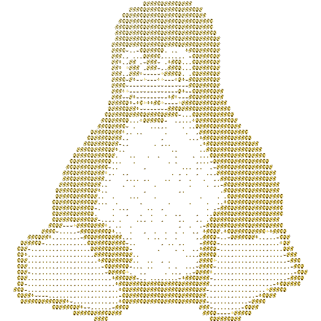

# TUXTYPE

---
## How it Works
It'd probably be better if you explained it but ill try anyways. 
Tuxtype includes various modes based on different distros. The commands for these modes are obtained directly from a special script that scrapes them from a VM. Because they are harvested directly from the system, and not manually sorted through a LLM, the syntax and combination of flags remain true to the source. We simply extract this data and convert it into user-friendly strings that are randomly assigned to be the next prompt (again, given the user selected mode/distro). 

Aside from this, much of the frontend was obviously inspired by [monkeytype](https://www.monkeytype.com), and uses nothing more than standard CSS. 
